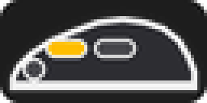
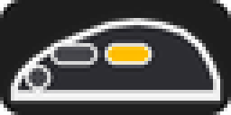
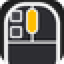
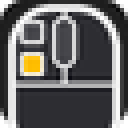
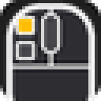

# IconosRaton

Addon de uso personal. En las barras de acción de Blizzard, cambia el texto de los atajos de los botones
del ratón ("Botón 4", "s+Botón 5"…) y de F10–F12 por un icono del ratón con el botón resaltado en amarillo:

| Atajo de WoW | Botón del G502 | Icono |
|---|---|---|
| `BUTTON5` | G5, lateral de delante |  |
| `BUTTON4` | G4, lateral de atrás |  |
| `BUTTON3` | Clic de la rueda |  |
| `F10` | G6, la diana (G HUB la envía como F10) |  |
| `F11` | G7 (G HUB la envía como F11) |  |
| `F12` | G8 (G HUB la envía como F12) |  |

Los modificadores van delante: `S+` (Mayús), `C+` (Ctrl), `A+` (Alt). Solo cambia lo que se ve; los
atajos no se tocan.

- Cubre las ocho barras de Blizzard (`ActionButtonUtil.ActionBarButtonNames`). No cubre Bartender4 ni
  las barras de mascota y de forma.
- Instalado mediante junction en `_retail_` y `_forever_` (`Interface\AddOns\IconosRaton`). Un addon nuevo
  necesita reiniciar el cliente la primera vez.
- G6, G7 y G8 cambian los DPI de fábrica; en el perfil "World of Warcraft" de G HUB están reasignados a
  F10, F11 y F12. Por eso el addon dibuja esas tres teclas como el ratón, también si se pulsan en el teclado.
  Si cambias la asignación en G HUB, cambia la tabla `ICONOS` de `IconosRaton.lua`.
- Vista lateral (apaisada) para G4, G5 y G6; vista superior de la parte delantera para G7, G8 y la rueda.
- Los iconos (`media/*.tga`) salen de `docs/generar_iconos.py`; las vistas previas están en `docs/`.
